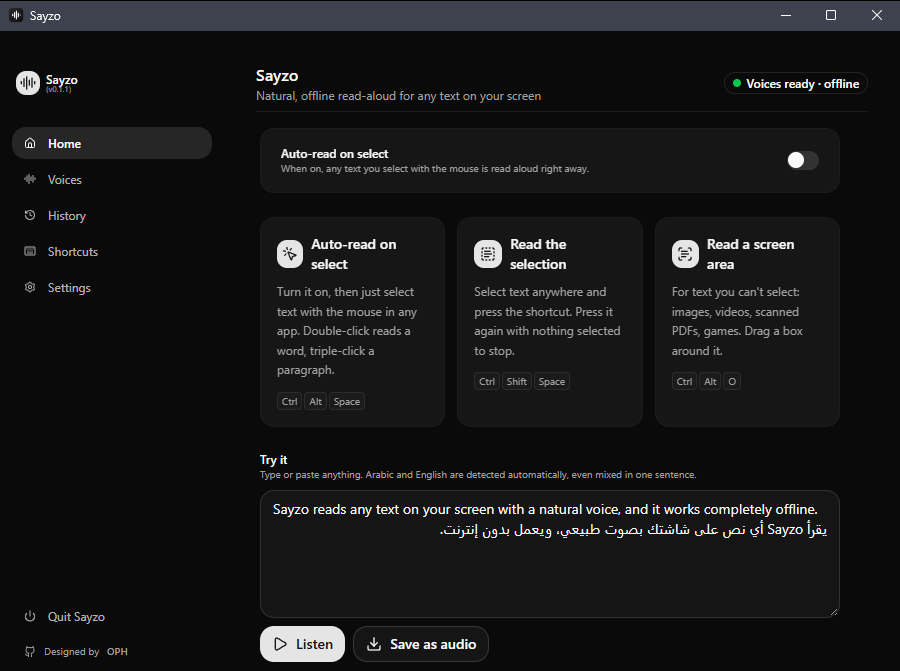
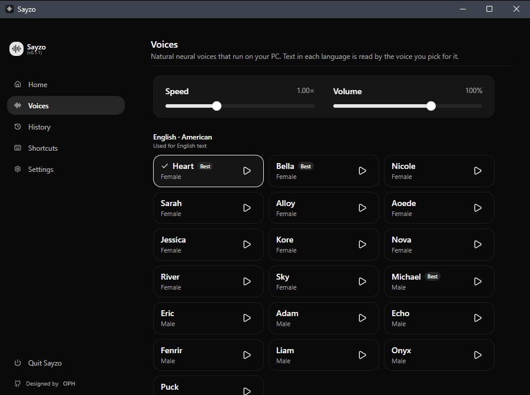
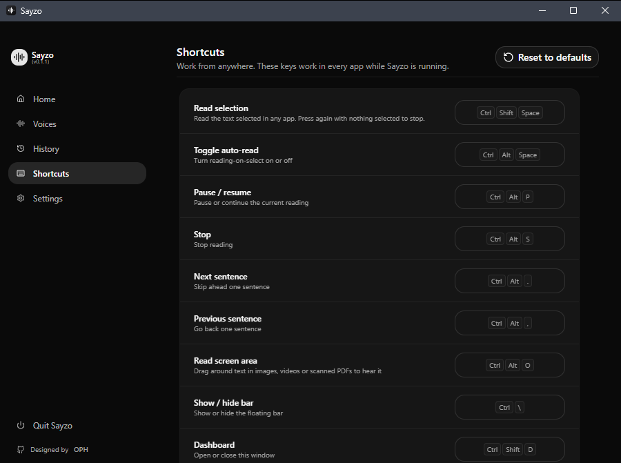
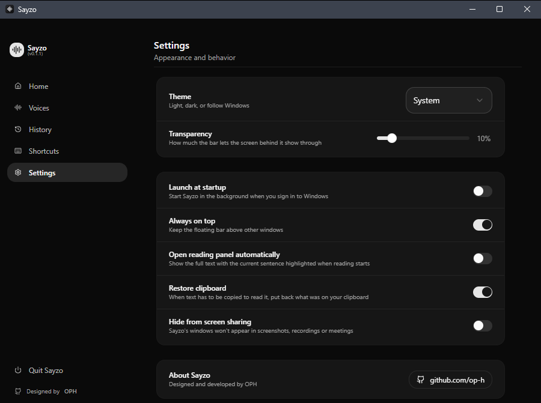

<div align="center">


# Sayzo

**Select any text on your screen and hear it read aloud, with natural voices that run entirely offline.**

[](https://github.com/op-h/sayzo/releases)
[](https://github.com/op-h/sayzo/actions/workflows/ci.yml)

[](LICENSE)

Designed and developed by [**OPH**](https://github.com/op-h)

[**⬇ Download for Windows**](https://github.com/op-h/sayzo/releases/latest)

<br />


</div>

---

Sayzo is a small glass bar that floats at the top of your screen. Select text in any app (a browser, a PDF, Word, a chat, a terminal) and Sayzo reads it with a human-sounding neural voice. There's no account, no cloud and no subscription. The voices run on your own CPU, and no text ever leaves your PC.

## Features

- **Natural voices, fully offline.** English uses Kokoro-82M (27 American and British voices) and Arabic uses Piper (male and female). Both run locally through sherpa-onnx.
- **Three ways to listen:**
  - **Auto-read on select.** Turn it on and just highlight text. A double-click reads a word and a triple-click reads a paragraph.
  - **Read selection.** Select text and press a shortcut.
  - **Read a screen area.** Drag a box around text you can't select (images, videos, scanned PDFs, games). It's recognized with the OCR built into Windows.
- **Mixed-language reading.** Arabic and English are detected per sentence, and the voice switches mid-sentence for mixed text such as "أستخدم Kali Linux كل يوم".
- **Starts fast.** Speech is generated sentence by sentence while earlier sentences play, so you hear the first words almost immediately.
- **Reading panel.** Shows the full text with the current sentence highlighted. Click any sentence to jump to it.
- **Smart text cleanup.** Re-joins PDF and web line breaks, fixes hyphenated words, and skips URLs and markdown symbols.
- **Respects your clipboard.** Sayzo reads selections through UI Automation where it can. When it has to copy, your clipboard is restored afterwards.
- **Save as audio.** Any text can be exported as a WAV file to `Music\Sayzo`.
- **Desktop extras.** Follows your audio device, keeps a history, sits in the tray, can launch at startup, can hide from screen sharing, and has fully customizable shortcuts plus light, dark and transparent themes.

## Screenshots

| Home | Voices |
|---|---|
|  |  |
| **Shortcuts** | **Settings** |
|  |  |

## Download

1. Go to the [**Releases**](https://github.com/op-h/sayzo/releases) page.
2. Download `Sayzo_x.y.z_x64-setup.exe` and run it. No admin rights are needed.
3. Sayzo starts in the tray, and the bar appears at the top of the screen.

The installer is about 430 MB because the voice models are bundled, which is what lets Sayzo work offline.

## Keyboard shortcuts

| Action | Default |
|---|---|
| Read selected text (press again with nothing selected to stop) | `Ctrl` + `Shift` + `Space` |
| Toggle auto-read on select | `Ctrl` + `Alt` + `Space` |
| Read text from a screen area (OCR) | `Ctrl` + `Alt` + `O` |
| Pause / resume | `Ctrl` + `Alt` + `P` |
| Stop | `Ctrl` + `Alt` + `S` |
| Next / previous sentence | `Ctrl` + `Alt` + `.` / `,` |
| Show / hide the bar | `Ctrl` + `\` |
| Open the dashboard | `Ctrl` + `Shift` + `D` |

All shortcuts can be changed in **Dashboard → Shortcuts**.

## Build from source

**Requirements:** Windows 10/11, [Rust](https://rustup.rs) (MSVC toolchain), [Node.js](https://nodejs.org) 18+, Visual Studio Build Tools (Desktop development with C++), and WebView2 (preinstalled on Windows 11).

```powershell
git clone https://github.com/op-h/sayzo.git
cd sayzo

# 1. Fetch the voice models (~490 MB) into src-tauri/models
powershell -ExecutionPolicy Bypass -File scripts/download-models.ps1

# 2. Install dependencies and run
npm install
npm run tauri dev

# 3. Build the installer (output: src-tauri/target/release/bundle/nsis)
npm run tauri build
```

Run the tests with `cargo test` in `src-tauri`. The voice tests need the models: `cargo test -- --ignored`.

## Project structure

```
sayzo/
├── src/                    React + TypeScript UI
│   ├── bar/                Floating bar, reading panel, quick settings
│   ├── dashboard/          Home, Voices, History, Shortcuts, Settings
│   ├── ocr/                Screen-area picker overlay
│   └── components/ui/      UI primitives (shadcn/Radix)
├── src-tauri/              Rust backend (Tauri 2)
│   └── src/
│       ├── tts.rs          Kokoro and Piper engines via sherpa-onnx
│       ├── reader.rs       Streaming playback, sentence tracking, WAV export
│       ├── text.rs         Text cleanup, sentence and language splitting
│       ├── selection.rs    Selected-text capture (UI Automation + clipboard)
│       ├── mouse_hook.rs   Selection gestures for auto-read
│       ├── ocr.rs          Screen capture + Windows OCR
│       └── shortcuts.rs    Global hotkeys
├── scripts/                Model download script
└── .github/                CI, release workflow, issue templates
```

## Tech stack

[Tauri 2](https://tauri.app) · Rust · React 19 · TypeScript · Tailwind CSS 4 · [sherpa-onnx](https://github.com/k2-fsa/sherpa-onnx) · rodio · Windows UI Automation and OCR

## Contributing

Bug reports and pull requests are welcome. See [CONTRIBUTING.md](CONTRIBUTING.md).

## Credits

- Interface design inspired by and partly based on [Pluely](https://github.com/iamsrikanthnani/pluely) (GPL-3.0).
- English voices: [Kokoro-82M](https://huggingface.co/hexgrad/Kokoro-82M) by hexgrad (Apache-2.0).
- Arabic voices: Piper models by [OpenVoiceOS](https://huggingface.co/OpenVoiceOS).
- Speech engine: [sherpa-onnx](https://github.com/k2-fsa/sherpa-onnx) by k2-fsa (Apache-2.0).

The full list is in [THIRD_PARTY_NOTICES.md](THIRD_PARTY_NOTICES.md).

## License

Sayzo is free software released under the [GNU General Public License v3.0](LICENSE).

<div align="center">
<sub>Made with care by <a href="https://github.com/op-h">OPH</a></sub>
</div>
